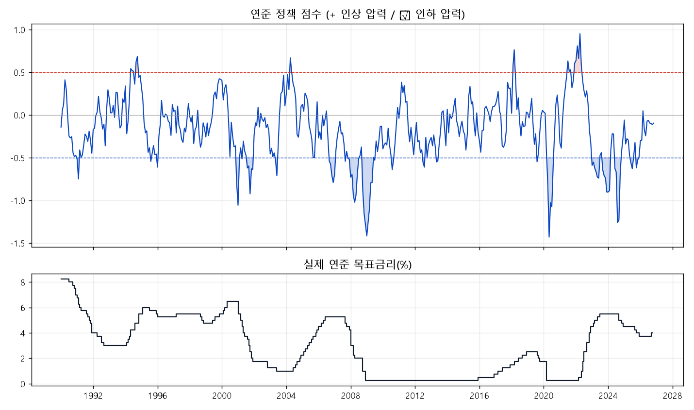

# Fed Policy Change Detector

FRED 공개 데이터만으로 **지금 연준 기조가 인하·동결·인상 중 어느 쪽으로 기울어 있는지** 점수로 판단하고, 매주 텔레그램으로 받아보는 도구입니다. 판단 규칙은 과거 데이터로 검증했습니다.

## 어떻게 판단하나

세 가지 재료를 각각 점수로 만든 뒤 합칩니다. 점수가 +면 인상 압력, −면 인하 압력입니다.

| 재료 | 쓰는 지표 | 가중치 |
|---|---|---|
| 물가 | 근원 PCE 3개월 연율, CPI 세부 12개 품목 확산지수 | 0.4 |
| 경기 | Hard(고용·Sahm 지표·산업생산·실질 소매판매) + Soft(미시간 소비자심리·필라델피아·뉴욕 연은 설문) | 0.3 |
| 시장 | 2년물 국채금리 − 기준금리 | 0.3 |

- 각 지표는 **그 시점까지의 과거만으로** z점수(과거 평균 대비 몇 표준편차인지)로 바꿉니다.
- 지표마다 **발표 시차**를 반영합니다. 예를 들어 10월 말에는 9월 고용까지만 알 수 있으므로, 10월 판단에 10월 고용을 쓰지 않습니다.
- 점수 ≥ +0.5면 인상 쪽, ≤ −0.5면 인하 쪽, 그 사이면 동결로 판단합니다.

**물가 확산지수**: CPI 세부 품목 중 최근 3개월 상승 속도가 최근 1년 상승률보다 빠른 품목의 비율입니다. 높을수록 물가 압력이 일부 품목이 아니라 넓게 퍼지고 있다는 뜻입니다.

## 검증 방법

1990년 이후 매달 말의 판단을, 그 뒤 6개월 안에 실제로 일어난 첫 금리 변경(0.25%p 이상)과 비교합니다. 시장 지표는 이미 연준 예상을 담고 있으므로, **시장 지표를 뺀 '매크로만' 모델도 따로 검증**해 경제지표 자체의 설명력을 확인합니다.

<!-- python backtest.py 실행 후 결과를 여기에 정리 -->


## 실행

```bash
pip install -r requirements.txt
cp .env.example .env        # FRED_API_KEY, TELEGRAM_TOKEN, TELEGRAM_CHAT_ID 입력
python fred_data.py         # 데이터 받기 확인
python backtest.py          # 과거 검증 → docs/score.png, docs/backtest.csv
python report.py --dry      # 리포트 미리보기
python report.py            # 텔레그램 전송
```

매주 월요일 09:00(KST)에 GitHub Actions가 자동으로 리포트를 보냅니다 (`.github/workflows/weekly.yml`).

## 한계

- FRED는 **수정된 최신 값**을 줍니다. 발표 당시 숫자와 다를 수 있어 과거 검증이 실제보다 좋게 나올 수 있습니다 (개선 방향: ALFRED 발표 당시 값 사용).
- 가중치와 ±0.5 기준은 사람이 정한 값입니다. 바꾸면 반드시 다시 검증해야 하고, 검증 결과에 맞춰 반복 조정하면 과최적화가 됩니다.
- 제로금리 구간(2009~2015, 2020~2022)에는 동결이 길게 이어져 동결 적중률이 부풀려질 수 있습니다.
- 투자 참고용이며 매매 신호가 아닙니다.
